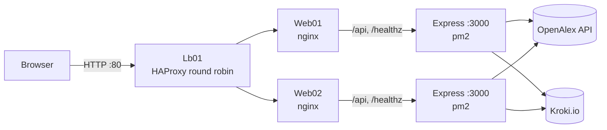

<div align="center">


# Ukuri Research Auditor

**Find papers, cite them in APA 7, and catch ghost, mismatched or retracted references before your reader does.**

Ukuri means _truth_ in Kinyarwanda.

[](https://nodejs.org)
[](https://expressjs.com)
[](https://openalex.org)
[](https://kroki.io)
[](https://mozilla.github.io/pdf.js/)

[Live demo](#links) · [Features](#features) · [Run locally](#running-locally) · [Deployment](#deployment) · [API](#api-reference)

</div>

---

## Links

|                        |                             |
| ---------------------- | --------------------------- |
| Live application       | _TBD_                       |
| Demo video             | _TBD_                       |
| OpenAlex documentation | <https://docs.openalex.org> |
| Kroki documentation    | <https://docs.kroki.io>     |

## Overview

Students and researchers lose marks, and sometimes credibility, to references that do not
exist, point to the wrong paper, or cite work that has since been retracted. AI writing
tools have made "ghost citations" more common. Ukuri checks every entry in a reference list
against [OpenAlex](https://openalex.org), an open index of about 250 million scholarly works,
and tells you which ones hold up.

It also covers the steps around the audit: searching the literature, building correct
APA 7 references, and keeping a reading list you can export to any reference manager.

<!-- Screenshot: save one as public/assets/screenshot.png and uncomment the line below.
<p align="center"></p>
-->

## Features

### Search

- Keyword search across OpenAlex with year range, work type, open access and sort filters.
- Composer-style search box that starts centred and docks to the top once results load.
- Shareable result URLs (`/?q=...`), keyboard shortcut (`/` to focus, `Esc` to reset).
- One click to cite a result or save it to the reading list.

### Cite (APA 7)

- One lookup box for a DOI, a doi.org or OpenAlex link, or a paper title (with a pick list).
- Live APA 7 reference plus parenthetical and narrative in-text citations.
- Output as **APA 7**, **BibTeX** or **RIS**; rich copy keeps italics when pasting into Word or Google Docs.
- Missing-information checks (no DOI, no year, no volume) that jump to the right field.
- Retraction warning when the loaded work has been retracted.
- Edits keep the link to OpenAlex; drafts and the selected work survive a reload.
- Citation map of the work and the papers it references, with zoom, pan, full screen and SVG download.

### Audit references

- Paste a list or upload a PDF; the References section is extracted **in the browser** with pdf.js, so the file never leaves your machine.
- Every entry gets a verdict: **valid**, **mismatch**, **likely ghost**, **retracted** or **unverifiable**, with a match score and the reason.
- Results stream in batch by batch with real progress, an ETA and a stop button.
- Report with an integrity score, a verdict breakdown bar, filters, and sorting by severity, list order or match score.
- Expandable rows compare your reference with the OpenAlex record field by field and highlight differences.
- **Citation network** diagram: which of your references cite each other, and which outside papers several of them build on.
- Exports: corrected reference list (`.txt`) and a full audit report (`.csv`). The last audit is restored on reload.

### Reading list

- Saved works with stats (count, year span, total citations, open access share) and a retraction notice.
- Filter as you type, filter chips, five sort orders, multi-select with bulk copy, export and remove (with undo).
- Export to **APA 7** `.txt`, **BibTeX** `.bib`, **RIS** `.ris` (Zotero, Mendeley, EndNote) or **CSV**.
- Citation map across the papers currently in view.

### Infrastructure

- Two identical web servers behind an HAProxy round-robin load balancer with health checks.
- A live server chip in the top bar shows which backend answered, so you can watch requests alternate.

## Tech stack

| Layer           | Choice                                                 | Why                                                                           |
| --------------- | ------------------------------------------------------ | ----------------------------------------------------------------------------- |
| Frontend        | HTML, CSS, vanilla ES modules                          | No build step; nginx serves `public/` as is                                   |
| API             | Node.js 20, Express 4                                  | Thin proxy that keeps the OpenAlex key server side                            |
| Data            | [OpenAlex API](https://docs.openalex.org)              | Open (CC0) metadata, DOIs, citation counts, retraction flags, reference lists |
| Diagrams        | [Kroki.io](https://kroki.io)                           | Renders Mermaid and Graphviz source to SVG, so no chart library is shipped    |
| PDF parsing     | [pdf.js](https://mozilla.github.io/pdf.js/) (vendored) | Client-side text extraction                                                   |
| Web server      | nginx                                                  | Static files, gzip, caching, reverse proxy to Express                         |
| Process manager | pm2 (SysVinit script)                                  | Keeps the API running across crashes and reboots                              |
| Load balancer   | HAProxy                                                | Round robin with `/healthz` checks                                            |

## Architecture



- The browser only ever calls same-origin `/api/*`. The OpenAlex key lives in `.env` on each web server.
- Express binds to `127.0.0.1`, so it is reachable only through nginx on the same machine.
- The API is stateless (an in-memory cache aside), so any request can land on either web server.
  The audit page sends references in batches of five; consecutive batches may be served by different backends.

## Running locally

**Requirements:** Node.js 20 or newer, and an [OpenAlex API key](https://openalex.org) (free).

```bash
git clone https://github.com/ndizeyedavid/ukuri-research.git
cd ukuri-research
npm install
cp .env.example .env        # then fill in OPENALEX_API_KEY and MAILTO
npm run dev                 # restarts on file changes
```

Open <http://127.0.0.1:3000>. Express serves `public/` itself in development, so nginx is not needed locally.

### Environment variables

| Variable           | Required    | Default     | Purpose                                                    |
| ------------------ | ----------- | ----------- | ---------------------------------------------------------- |
| `OPENALEX_API_KEY` | yes         |             | Sent with every OpenAlex request                           |
| `MAILTO`           | recommended |             | Contact email for the OpenAlex polite pool                 |
| `PORT`             | no          | `3000`      | Port Express listens on                                    |
| `HOST`             | no          | `127.0.0.1` | Interface Express binds to                                 |
| `SERVER_NAME`      | no          | `local`     | Shown in the server chip and `/healthz` (`web01`, `web02`) |

### Scripts

| Command                 | Description                                                                                                                      |
| ----------------------- | -------------------------------------------------------------------------------------------------------------------------------- |
| `npm start`             | Start the server                                                                                                                 |
| `npm run dev`           | Start with `node --watch`                                                                                                        |
| `npm test`              | Offline parser checks: 15 reference formats (APA, Harvard, IEEE, MLA, Chicago, Vancouver, edge cases)                            |
| `npm run test:live`     | Full matcher against live OpenAlex: real papers, planted fakes, mutations, a retraction (needs `.env`)                           |
| `npm run test:sample`   | Audits `test/sample.txt`, a 43-entry reference list extracted from a journal PDF, against live OpenAlex                          |
| `node test/battery.mjs` | Run the audit test battery and a concurrency check against a running server (`BASE=http://host:port` to target another instance) |

## API reference

All routes return JSON unless noted. Upstream OpenAlex responses are cached in memory for 10 minutes.

| Method | Route                                                                | Description                                                                                                    |
| ------ | -------------------------------------------------------------------- | -------------------------------------------------------------------------------------------------------------- |
| `GET`  | `/api/search?q=&year_from=&year_to=&oa=&type=&sort=&page=&per_page=` | Search works. `sort` is `relevance`, `cited_by_count` or `publication_date`; `per_page` max 25                 |
| `GET`  | `/api/work/:id`                                                      | One work by OpenAlex id (`W2626778328`) or DOI (`doi:10.48550/arxiv.1706.03762`)                               |
| `GET`  | `/api/works?ids=W1,W2`                                               | Up to 20 works in one call (used for citation maps and the network)                                            |
| `POST` | `/api/audit-match`                                                   | Body `{ "refs": string[] }`, max 100. Returns a verdict per reference                                          |
| `POST` | `/api/mindmap`                                                       | Body `{ "engine": "mermaid" \| "graphviz" \| "plantuml", "source": string }`. Returns sanitised SVG from Kroki |
| `GET`  | `/api/whoami`                                                        | `{ "server": "web01" }`                                                                                        |
| `GET`  | `/healthz`                                                           | `{ "ok": true, "server": "web01" }` for HAProxy                                                                |

## How the audit works

1. **Split** the list into entries (one per line or blank-line separated; PDF lines are re-joined).
2. **Parse** each entry for a DOI, year, first author surname and title. The parser recognises APA, Harvard, IEEE, MLA, Chicago and Vancouver layouts: quoted titles, years in or out of parentheses, numbered entries, and author lists with or without a year.
3. **Short-circuit** books, web pages and reports (ISBN, "Retrieved from", "Accessed on") as _unverifiable_. A reference that only carries a non-DOI link is still looked up; if nothing matches it is reported as unverifiable rather than as a ghost.
4. **DOI path:** resolve the DOI on OpenAlex. Retracted, title mismatch or a year off by more than one gives _retracted_ or _mismatch_; otherwise _valid_.
5. **Title path:** search the title and score the top candidates. If nothing scores 75 or more, search again with the first author's surname, then with a title-only query narrowed to the cited year.

The score is `70% title similarity + 15% year closeness + 15% author surname match`. Title similarity tolerates a missing or extra subtitle. Short titles (under four meaningful words) can only score as valid when the author and year also agree.

| Verdict      | Rule                                                             |
| ------------ | ---------------------------------------------------------------- |
| Valid        | DOI resolves cleanly, or best title match scores 75 or more      |
| Mismatch     | DOI resolves but details disagree, or best match scores 50 to 74 |
| Likely ghost | No candidates, or best match below 50                            |
| Retracted    | The matched work is flagged retracted in OpenAlex                |
| Unverifiable | Not a journal-style reference, or too little to search on        |

The integrity score is valid references divided by verifiable references.

## Deployment

Everything needed lives in [`infra/`](infra):

| File                                                 | Purpose                                                             |
| ---------------------------------------------------- | ------------------------------------------------------------------- |
| [`deploy.sh`](infra/deploy.sh)                       | Idempotent setup and update script for Web01 and Web02              |
| [`nginx-ukuri.conf`](infra/nginx-ukuri.conf)         | nginx vhost: static files, gzip, caching, `/api` proxy, branded 404 |
| [`ecosystem.config.cjs`](infra/ecosystem.config.cjs) | pm2 process definition                                              |
| [`ukuri.init`](infra/ukuri.init)                     | SysVinit script for the API, boots pm2 on systemd-less hosts        |
| [`haproxy.cfg`](infra/haproxy.cfg)                   | Lb01 round robin with health checks                                 |
| [`firewall-notes.md`](infra/firewall-notes.md)       | UFW rules for all three servers                                     |
| [`verify.sh`](infra/verify.sh)                       | End-to-end checks, including a round-robin count                    |

### 1. Web01 and Web02

```bash
ssh ubuntu@18.130.141.151
git clone https://github.com/ndizeyedavid/ukuri-research.git /tmp/ukuri
sudo bash /tmp/ukuri/infra/deploy.sh web01 https://github.com/ndizeyedavid/ukuri-research.git
sudo nano /var/www/ukuri-research/.env    # add OPENALEX_API_KEY and MAILTO
sudo bash /var/www/ukuri-research/infra/deploy.sh web01
```

Repeat on Web02 with `web02`. The script installs Node.js 20, nginx and pm2, installs
dependencies, writes the nginx site, starts the API under pm2 with boot persistence, and
ends with a smoke test. Re-run it after every `git push` to update a server.

### 2. Lb01

```bash
sudo apt-get install -y haproxy
sudo cp infra/haproxy.cfg /etc/haproxy/haproxy.cfg
sudo sed -i 's/WEB01_IP/18.130.141.151/; s/WEB02_IP/18.171.135.64/' /etc/haproxy/haproxy.cfg
sudo haproxy -c -f /etc/haproxy/haproxy.cfg && sudo service haproxy restart
```

### 3. Firewall

Apply the UFW rules in [`firewall-notes.md`](infra/firewall-notes.md). Port 3000 is never exposed.

### 4. Verify

```bash
bash infra/verify.sh 35.179.139.142 18.130.141.151 18.171.135.64
```

The script checks each server directly, then sends ten requests through the load balancer
and confirms that both `web01` and `web02` answered. In the browser, refresh any page and
watch the server chip in the top bar change, or open the Credits page.

## Project structure

```
.
├── infra/                  deployment configs and scripts
├── public/                 static frontend served by nginx
│   ├── index.html          search
│   ├── cite.html           APA 7 citation builder
│   ├── audit.html          reference auditor
│   ├── reading-list.html   saved works
│   ├── credits.html        data, libraries and design credits
│   ├── 404.html
│   ├── styles.css          design tokens and all styles
│   ├── partials/           sidebar and toast, injected at runtime
│   ├── js/                 one ES module per page plus shared modules
│   └── vendor/pdfjs/       vendored pdf.js build
├── server/
│   ├── index.js            Express routes, Kroki proxy, static fallback
│   ├── openalex.js         OpenAlex client, TTL cache, response trimming
│   └── match.js            reference parsing, scoring and verdicts
├── test/battery.mjs        audit accuracy and concurrency checks
├── .env.example
└── package.json
```

## Security

- The OpenAlex key never reaches the browser or the repository (`.env` is gitignored).
- Express listens on `127.0.0.1` only; UFW also blocks port 3000.
- Inputs are validated and capped on the server (query length, 100 references, 256 KB JSON body).
- All OpenAlex text is inserted with `textContent`; Kroki SVG is stripped of scripts and event handlers before it is returned.
- nginx sends `X-Content-Type-Options`, `X-Frame-Options` and `Referrer-Policy` headers and hides its version.

## Challenges and fixes

| Challenge                                                                                                                                             | Fix                                                                                                                                                                          |
| ----------------------------------------------------------------------------------------------------------------------------------------------------- | ---------------------------------------------------------------------------------------------------------------------------------------------------------------------------- |
| Reference lists extracted from PDFs arrive as broken lines, not entries                                                                               | A splitter that rejoins wrapped lines using author and year patterns, plus an editable preview before auditing                                                               |
| pdf.js output from real journals: no hanging indent, page footers glued to entries, spaces inside DOIs and names (`10.1186/s40360 - 020 -`, `Mili ć`) | Numbered-list splitting that follows the 1, 2, 3 sequence, removal of repeated page furniture, and a repair pass that rejoins hyphens, DOIs and split letters before parsing |
| Vancouver variants with no full stop between authors and title (`and SB Obakiro The Scourge of...`)                                                   | A dedicated author-block pattern for initials-last and initials-first names                                                                                                  |
| Online-first papers cited with the print year                                                                                                         | A DOI match with a matching title tolerates up to three years and says why                                                                                                   |
| Long audits held one HTTP request open for up to a minute behind two proxies                                                                          | The client sends batches of five, which gives real progress and keeps each request well inside proxy timeouts                                                                |
| OpenAlex rate limits during audit bursts                                                                                                              | Polite-pool `mailto`, 120 ms spacing between lookups and a 10 minute response cache                                                                                          |
| Some references are books or web pages that OpenAlex cannot confirm                                                                                   | Detected up front and reported as _unverifiable_ instead of being called ghosts                                                                                              |
| Kroki returns third-party SVG that is inserted into the page                                                                                          | Server-side proxy with an engine allowlist and SVG sanitising                                                                                                                |
| nginx dropped security headers on cached assets                                                                                                       | `add_header` in a `location` block discards inherited headers; caching now uses `expires`                                                                                    |

## Credits

- Scholarly metadata from [OpenAlex](https://openalex.org), released under CC0.
- Diagrams rendered by [Kroki](https://kroki.io).
- PDF parsing by [pdf.js](https://mozilla.github.io/pdf.js/) (Apache 2.0).
- Typefaces: [Fraunces](https://fonts.google.com/specimen/Fraunces), [Inter](https://fonts.google.com/specimen/Inter) and [JetBrains Mono](https://fonts.google.com/specimen/JetBrains+Mono) (SIL Open Font License).
- The clay accent and the zigzag and diamond motifs are drawn from Imigongo, the geometric panel art of Rwanda.

## Author

Built by [ndizeyedavid](https://github.com/ndizeyedavid) for the African Leadership University
Web Infrastructure course ("Playing Around with APIs").
